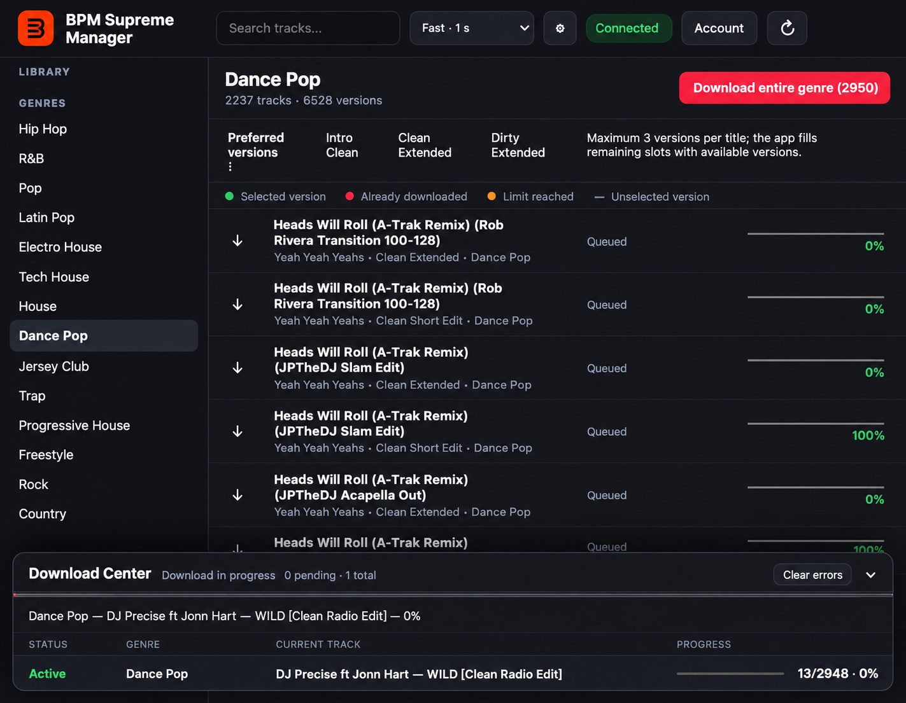
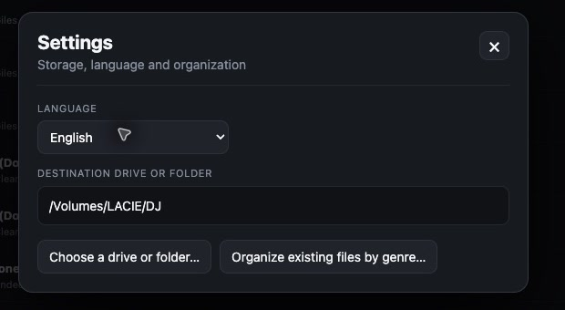

# BPM Supreme Manager

An unofficial cross-platform desktop companion created to make BPM Supreme easier to use and to automate authorized downloads from a valid user account.

**This application is exclusively for BPM Supreme members. An active, functional BPM Supreme account with access to the requested content is required.** The application cannot be used without valid membership and does not provide or unlock access on its own.

The application presents the catalogue by genre, prioritizes DJ-friendly versions, avoids duplicate downloads, and keeps the resulting library ready for Serato. It runs on macOS, Windows, and Linux from one Electron codebase.

> [!IMPORTANT]
> This is not the official BPM Supreme software. It is an independent community project and is not affiliated with, endorsed by, or sponsored by BPM Supreme or BPM Music. BPM Supreme names, logos, and related trademarks belong to their respective owners. This tool is reserved for BPM Supreme members and requires an active, functional account with access to the requested music. The application does not bypass subscriptions, access controls, download limits, or copyright restrictions. Users are responsible for following BPM Supreme's terms and all applicable laws.

## Why this project exists

BPM Supreme Manager was built to provide a simpler desktop workflow and automate repetitive download and library-organization tasks. It uses the access already granted to the signed-in user and is intended as a convenience tool for legitimate subscribers—not as a replacement for an account, a way around service restrictions, or an official BPM Supreme client.

## Screenshots

### Library and Download Center



### Settings



## Highlights

- Browse the available catalogue directly by genre.
- Search titles and download an entire genre or individual tracks.
- Prefer **Intro Clean**, **Clean Extended**, and **Dirty Extended** versions, with sensible fallbacks when those versions are unavailable.
- Limit selection to three versions per title.
- Choose any disk or destination folder.
- Store files directly as `DJ/Genre/Artist - Title [Version].mp3`, without collection folders.
- Detect previously downloaded music and skip duplicate files.
- Reorganize an existing library by genre without downloading it again.
- Generate one Serato-compatible `.m3u8` playlist per genre without duplicating audio files.
- Queue multiple genres in a compact download center.
- Display per-track and per-genre progress, including the current title and completion percentage.
- Automatically remove completed queue entries while leaving errors visible.
- Choose cautious, balanced, or fast pacing to reduce rate-limit errors.
- Pause and resume work after authentication expires.
- Preserve the authenticated session using Electron's operating-system-backed encrypted storage.
- Follow the system language by default, with English, French, and Spanish available in Settings.

## Installation

Prebuilt installers can be attached to the GitHub Releases page. The Windows package is currently unsigned, so Microsoft SmartScreen may display a warning. Build from source if you prefer to inspect and package the application yourself.

### Run from source

Requirements:

- Node.js 20 or later
- pnpm 9 or later

```bash
pnpm install
pnpm start
```

The application opens locally. Use **Connect** to authenticate on BPM Supreme's own website; credentials are never collected by this project.

## Build packages

```bash
pnpm run dist:mac
pnpm run dist:win
pnpm run dist:linux
```

Build artifacts are written to `dist/`. Native installers are most reliably generated on their target operating system.

## Library layout

New files use this structure:

```text
DJ/
└── Genre/
    ├── Artist - Title [Intro Clean].mp3
    ├── Artist - Title [Clean Extended].mp3
    └── Artist - Title [Dirty Extended].mp3
```

No collection subfolders are created. The organizer can move older files into this layout and updates the local registry and Serato playlists accordingly.

## Authentication and privacy

- Authentication happens in a dedicated window on the official BPM Supreme domain.
- The application never stores a username or password.
- Only the cookies required to restore the authenticated session are persisted.
- Persisted cookies are encrypted through Electron `safeStorage`, backed by the operating system's credential protection.
- Session data, local settings, download history, music, and build outputs are excluded from this repository.

## Rate limits

BPM Supreme may respond with HTTP `429 Rate limit reached` when requests arrive too quickly. The application includes three pacing modes:

- **Cautious:** 8 seconds between downloads and a 120-second pause after a rate limit.
- **Balanced:** 3 seconds between downloads and a 60-second pause after a rate limit.
- **Fast:** 1 second between downloads and a 30-second pause after a rate limit.

Balanced is the recommended default. A pacing mode reduces request frequency but cannot guarantee that the service will not enforce its own limits.

## Project structure

```text
src/main.js        Electron main process, authentication, API and downloads
src/preload.js     Secure renderer bridge
src/renderer.js    Interface state and download center
src/index.html     Application shell
src/styles.css     Responsive interface
build/             Packaging icons and Windows installer configuration
assets/            Source artwork used for packaging
```

## License

This project is available under the [MIT License](LICENSE). Contributions are welcome; see [CONTRIBUTING.md](CONTRIBUTING.md) for the development workflow and project guidelines.

